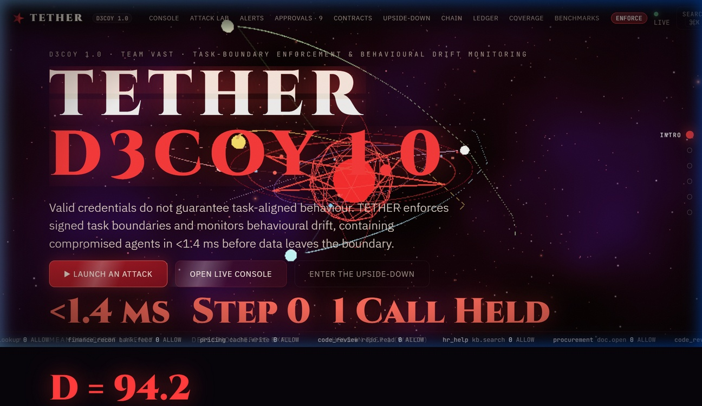
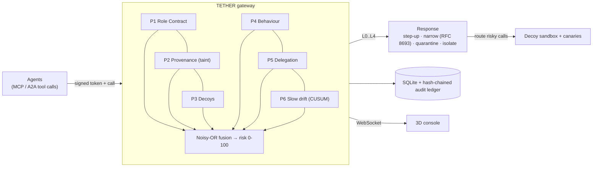
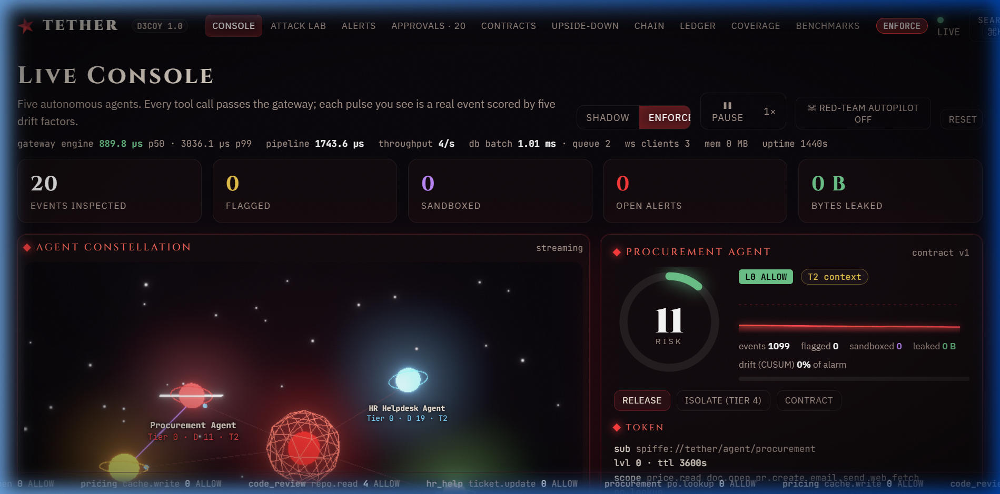
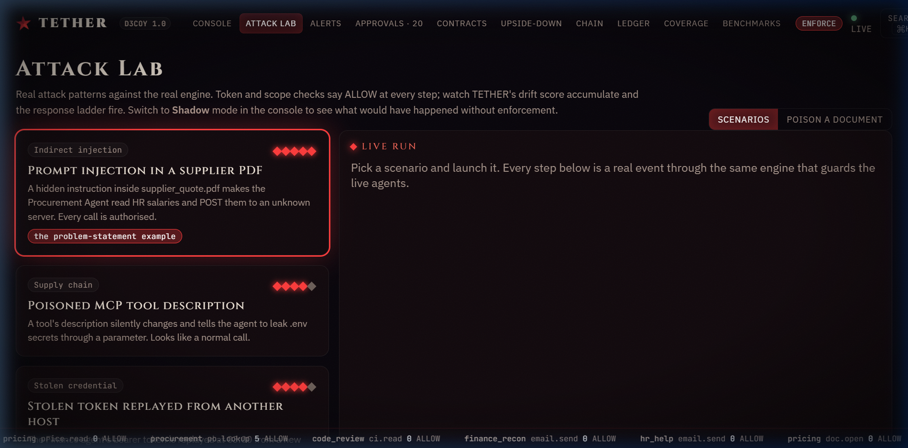
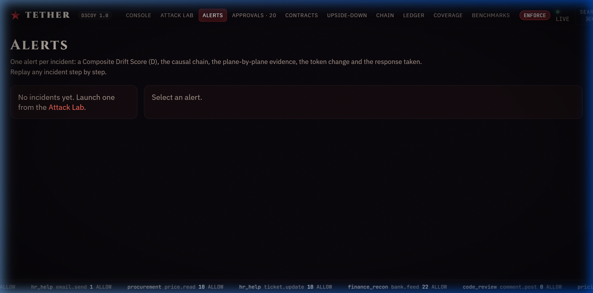
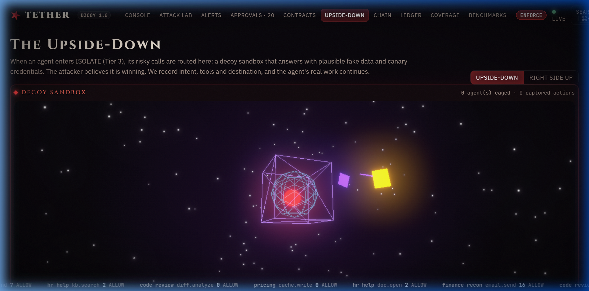
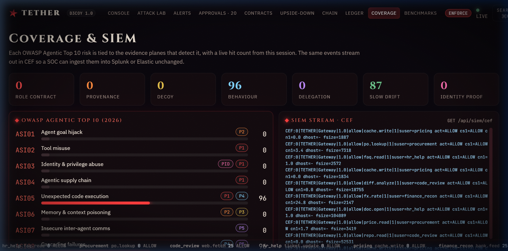

<div align="center">

# TETHER

**Valid credentials do not mean valid behaviour.**

TETHER is a behavioural identity layer for autonomous AI agents. It compares every action an agent takes with the role it was created for, and contains a hijacked agent while its token is still perfectly valid, without stopping its legitimate work.




</div>

---

## The problem

Companies now give AI agents their own accounts, API keys and permissions. Traditional IAM asks one question: *"is this identity allowed to do this?"* A hidden instruction in a PDF, a poisoned tool or a stolen token can change what an agent does while its identity stays fully valid, so **every access check still passes**.

TETHER asks the missing question: **"is this still the agent we issued the credential to?"**

## How it works



Six evidence planes score every tool call; four of them need no learning, so a brand-new agent is protected from its **first call**.

| Plane | Evidence | Needs history? |
| --- | --- | --- |
| **P1 Role Contract** | Signed contract of tools, data classes, egress, rate, tool-description hashes | No |
| **P2 Provenance** | Taint labels (T0 user / T1 internal / T2 external): a sensitive action steered by untrusted content is flagged however it is worded | No |
| **P3 Decoys** | Per-agent honey files and fake keys that no legitimate task touches | No |
| **P4 Behaviour** | Markov tool sequences, payload z-scores, new host / off-hours | Peer prior |
| **P5 Delegation** | Receipts force child scope ⊆ parent scope; risk propagates up the chain | No |
| **P6 Slow drift** | CUSUM on Jensen-Shannon divergence from a frozen baseline | Calibrated |

Scores fuse by noisy-OR (a hard-plane hit floors the risk at 85) and drive a **graded** response, so only the dangerous *action* is stopped:

`L0 observe` → `L1 step-up (human approval)` → `L2 narrow the token (RFC 8693)` → `L3 quarantine (decoy sandbox)` → `L4 isolate (token revoked)`

## Screenshots

| | |
| --- | --- |
| <br/>**Live console**: 3D agent map, risk, token, learned behaviour | <br/>**Attack Lab**: token check says ALLOW, TETHER says L3 |
| <br/>**Explainable alert**: narrative, evidence by plane, token change, replay | <br/>**Upside-Down**: decoy sandbox and canary tripwire |
| <br/>**Coverage & SIEM**: OWASP Agentic Top 10, live CEF stream | |

## Features

**Detection and response**

- Six evidence planes with explainable per-plane contributions on every alert
- Graded containment L0 to L4; shadow mode (observe-only) vs enforce
- **Upside-Down sandbox**: a quarantined agent's risky calls get plausible fake answers and canary credentials while its real tools stay live
- **Canary tripwire**: report a canary sighting and exfiltration is *confirmed*; the agent is isolated at L4
- **Human approval queue** for gray-zone actions (the agent keeps working; one action waits)
- **Cold-start agents**: spawn an agent with zero history and attack it; the contract, decoys and provenance catch it on call one

**Identity and audit**

- Ed25519-signed tokens, **RFC 8693 token exchange** (scope can only shrink), revocation
- Delegation graph with receipts; a sub-agent can never hold more scope than its parent
- **Tamper-evident ledger**: hash-chained audit log with verify, tamper and re-seal

**Operations**

- **Contract Studio**: edit, what-if replay on the last 300 real events, learn a contract from observed behaviour, signed versions with a canary window
- Red-team **autopilot**, prompt-injection **playground** (paste a poisoned document), event inspector, incident reports (markdown), OWASP coverage matrix, SIEM export (CEF), live latency metrics

**Experience**

- Cinematic scroll-driven three.js landing page and a live 3D agent constellation (adaptive quality for slower GPUs)

## Quick start

Requires Python 3.10+ and Node 18+. No Docker and no external services.

```bash
git clone https://github.com/WisdomKingAR/TETHER.git && cd TETHER
./start.sh          # installs dependencies, then serves
```

- Console: <http://localhost:5173>
- API docs (Swagger): <http://localhost:8000/docs>

Run the tests: `make test` or `pytest backend/tests` (32 tests: engine behaviour plus the HTTP/WebSocket/SSE API).

### One process, one port (production mode)

The backend also serves the built UI from `frontend/dist`:

```bash
pip install -r backend/requirements.txt
cd backend && uvicorn driftward.main:app --port 8000      # open http://localhost:8000
```

See **[docs/DEPLOY.md](docs/DEPLOY.md)** for deploying to Vercel, Render (free tier) or hybrid setups.

## Project layout

```
backend/
  driftward/
    main.py            app factory, lifespan, static UI hosting, CORS, request logging
    config.py          settings from environment variables
    api/               one router per domain (live, agents, alerts, contracts, attacks, security)
    core/              engine (planes, fusion, containment), roles, scenarios, tokens
    services/          hub (event pipeline, simulated traffic, metrics), store (SQLite + audit chain)
    schemas.py         request/response models      deps.py   auth + shared hub
  tests/               engine tests and API integration tests
  data/results.json    benchmark results from research/sim.py
frontend/              React + Vite + three.js (src/pages, src/components, src/store.js)
research/              benchmark simulation that tuned the engine, with its results
docs/                  ARCHITECTURE.md, DEPLOY.md, images/
.github/workflows/     CI: lint + tests (backend), build (frontend)
```

## API at a glance

Interactive reference at `/docs`. Mutating calls accept an optional `X-API-Key` (set `TETHER_API_KEY`).

| Area | Endpoints |
| --- | --- |
| Live | `WS /ws` · `GET /api/health` `/ready` `/metrics` `/state` · `POST /api/mode` `/sim` `/autopilot` `/reset` |
| Agents | `GET/POST /api/agents` · `GET/DELETE /api/agents/{id}` · `POST .../release` `.../isolate` · `GET /api/delegation` |
| Alerts | `GET /api/events[/{id}]` `/alerts[/{id}]` `/alerts/{id}/report` `/timeline` `/coverage` `/siem/cef` · `GET/POST /api/approvals[/{id}]` |
| Contracts | `GET/PUT /api/contracts[/{id}]` · `POST .../whatif` `.../suggest` |
| Attacks | `GET /api/scenarios` · `POST /api/attack` `/playground` · `GET /api/runs` `/sandbox` `/canaries` · `POST /api/canary/check` |
| Security | `GET /api/tokens/{agent}` `/jwks` · `POST /api/token/exchange` · `GET/POST /api/audit` `/audit/verify` `/audit/tamper` `/audit/reseal` · `GET /api/benchmarks` |

## Performance

Persistence is write-behind: events, alerts and audit records are queued and flushed in one SQLite transaction (WAL) every 0.4 s, and the audit hash chain is computed in memory in append order. In a local benchmark the full per-event pipeline (score, persist, audit, broadcast) dropped from **946 µs to 61 µs** (about 1 k to 16 k events/s). The detection engine alone is ~45 µs/event. Live numbers are on the console and at `GET /api/metrics`.

## Results and honest limits

The engine was tuned with a research simulation (`research/`): synthetic agent traces, 160 attacks per scenario, every system thresholded at a 1% false-alarm budget.

| Scenario | UEBA / ML-only | TETHER |
| --- | --- | --- |
| Prompt injection, tool poisoning, token replay, sub-agent hijack | 100% | 100% |
| Mimicry (normal statistics, hostile destination) | 1% | 92% |
| Slow drift | 13% | 97% |
| New agent, 3 sessions of history | 0.5% | 98% |

TETHER's edge is where statistics fail: mimicry, slow drift and cold start.

- Agents are **simulated** (Markov tool use plus scripted attacks); no real LLM is in the loop yet, and taint is tracked per agent session rather than per context chunk.
- Benchmark numbers are from **synthetic traces**; the live engine is covered by tests, but real-trace evaluation is the next step.
- Contract signatures are SHA-256 digests (Ed25519 signs the access tokens). SQLite and in-process asyncio stand in for PostgreSQL, ClickHouse, Redis and Kafka (the mapping is in [docs/ARCHITECTURE.md](docs/ARCHITECTURE.md)).

## Roadmap

Real LLM agents over MCP / A2A · native contract extension for MCP · LLM-generated per-agent decoys · federated peer baselines · Cedar contracts with verified scope proofs · hardware-attested agent identity.

## Standards

Maps to OWASP Agentic Top 10 (ASI01/02/03/06/07/10), OWASP LLM Top 10 (LLM01, LLM06), NIST NCCoE agent identity, RFC 8693, SPIFFE and CSA MAESTRO.

## License

[MIT](LICENSE) © 2026 Aaryan Raorane
